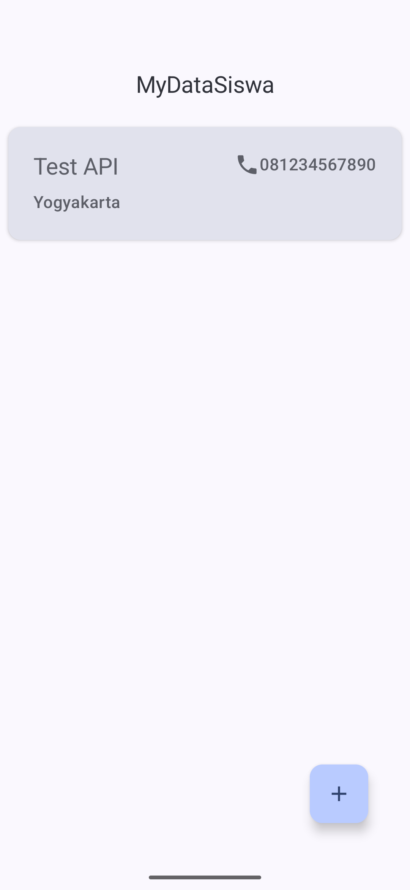
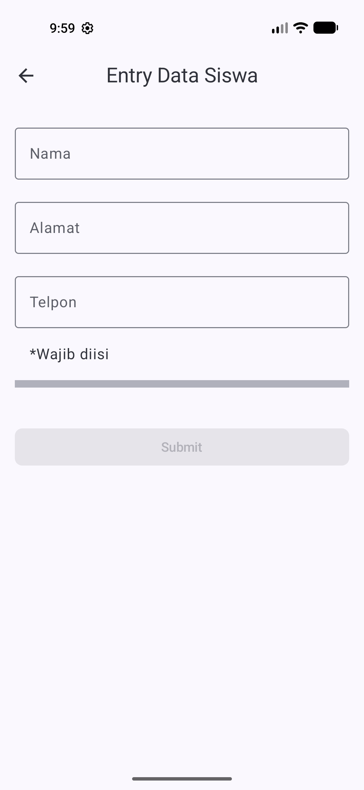
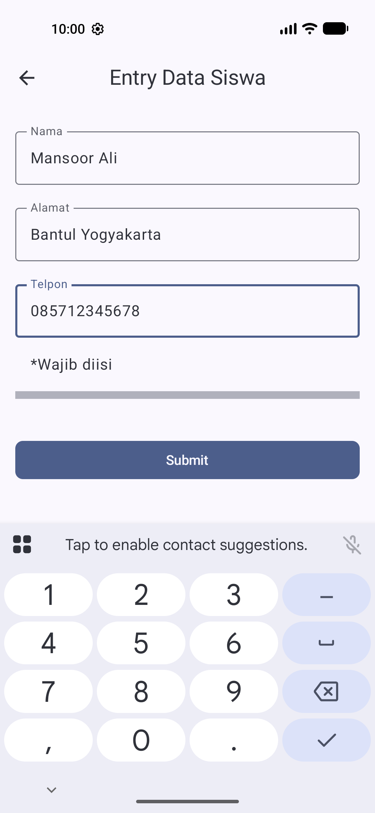
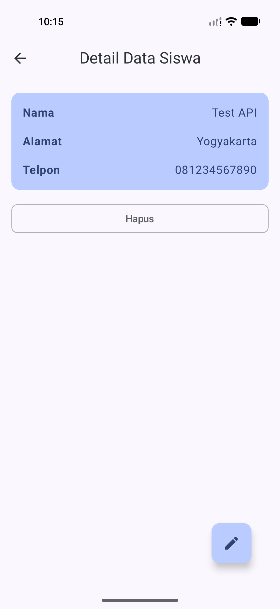
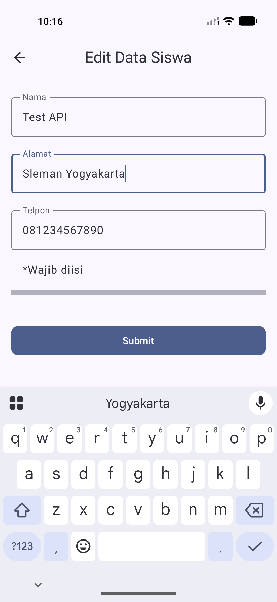
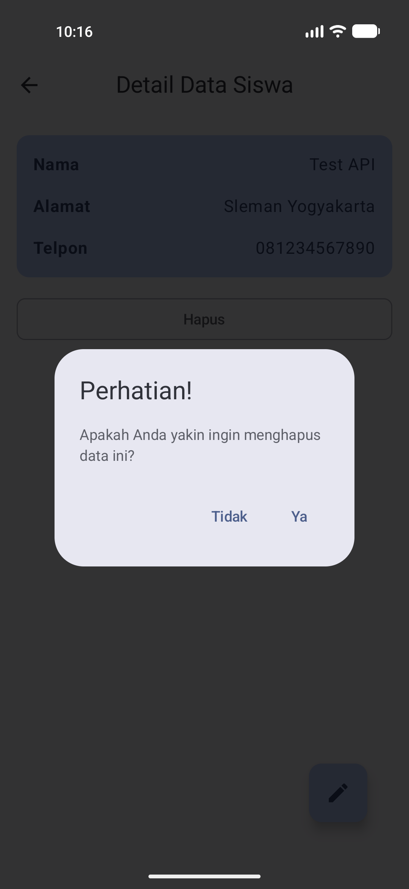
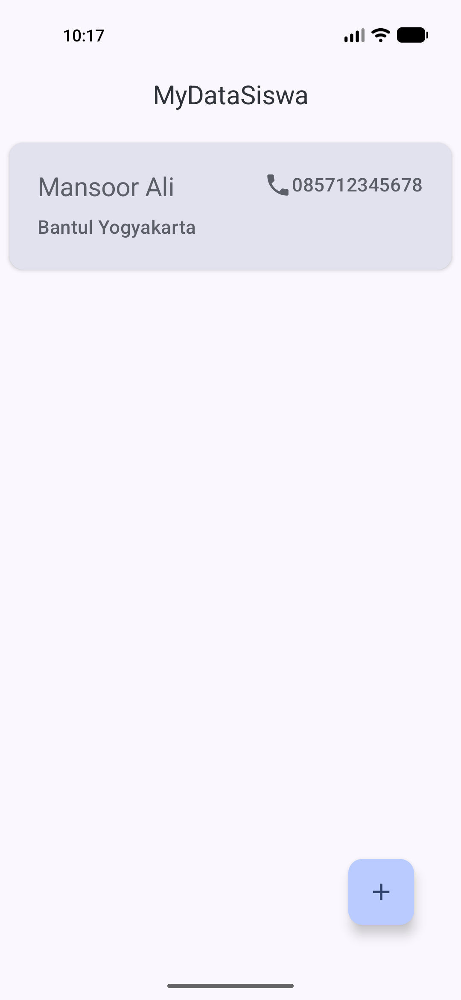

# MyDataSiswa (QuestAPI_0145)

Aplikasi Android Jetpack Compose untuk menampilkan, menambah, melihat detail,
mengubah, dan menghapus data siswa melalui REST API PHP + MySQL menggunakan
Retrofit dan Kotlinx Serialization.

## Screenshots

### Tampil & Tambah Data

| Home | Entry (kosong) | Entry (terisi) | Home setelah tambah data |
|:---:|:---:|:---:|:---:|
|  |  |  |  |

### Detail, Edit & Hapus Data

| Detail | Edit | Konfirmasi hapus | Home setelah hapus |
|:---:|:---:|:---:|:---:|
|  |  |  |  |

## Struktur
- `apiservice` – `ServiceApiSiswa`
- `modeldata` – `DataSiswa`
- `repositori` – `RepositoryDataSiswa`, `ContainerApp`, `AplikasiDataSiswa`
- `uicontroller` – route (`DestinasiHome`, `DestinasiEntry`, `DestinasiDetail`, `DestinasiEdit`) dan `PetaNavigasi`
- `view` – `HalamanHome`, `HalamanEntry`, `HalamanDetail`, `HalamanEdit`, `SiswaTopAppBar`
- `viewmodel` – `HomeViewModel`, `EntryViewModel`, `DetailViewModel`, `EditViewModel`, `PenyediaViewModel`

## Server

| Endpoint | Method | Fungsi |
|---|---|---|
| `bacaTeman.php` | GET | Ambil semua data siswa |
| `insertTM.php` | POST | Tambah data siswa |
| `bacaTemanDetail.php?id=` | GET | Ambil satu data siswa |
| `updateTM.php?id=` | POST | Ubah data siswa |
| `deleteTM.php?id=` | GET | Hapus data siswa |

Salin isi folder `server/` ke `htdocs/umyTI/` (XAMPP), lalu jalankan
`server/teman.sql` untuk membuat database `TIUMY` dan tabel `teman`.
Emulator mengakses server lewat `http://10.0.2.2/umyTI/`.
