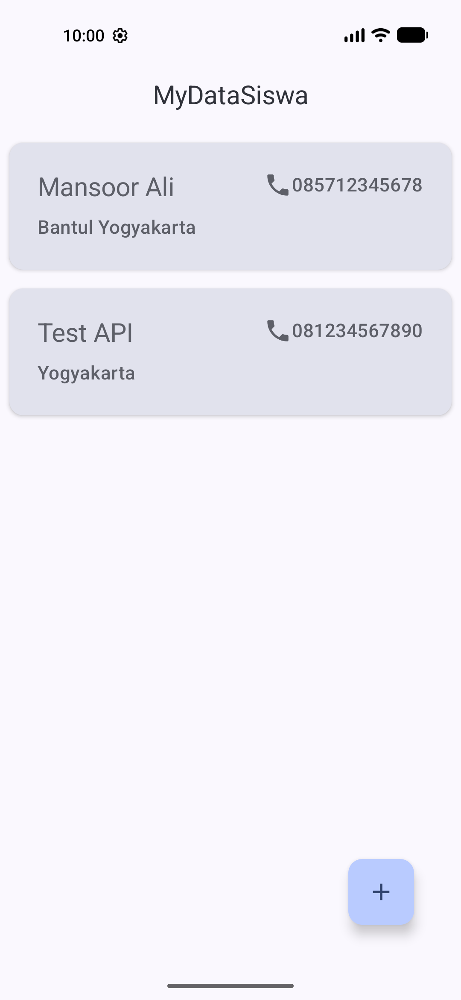

# MyDataSiswa (QuestAPI_0145)

Aplikasi Android Jetpack Compose untuk menampilkan dan menambah data siswa
melalui REST API PHP + MySQL menggunakan Retrofit dan Kotlinx Serialization.

## Screenshots

| Home | Entry (kosong) | Entry (terisi) | Home setelah tambah data |
|:---:|:---:|:---:|:---:|
|  |  |  |  |

## Struktur
- `apiservice` – `ServiceApiSiswa` (endpoint `bacaTeman.php`, `insertTM.php`)
- `modeldata` – `DataSiswa`
- `repositori` – `RepositoryDataSiswa`, `ContainerApp`, `AplikasiDataSiswa`
- `uicontroller` – route (`DestinasiHome`, `DestinasiEntry`) dan `PetaNavigasi`
- `view` – `HalamanHome`, `HalamanEntry`, `SiswaTopAppBar`
- `viewmodel` – `HomeViewModel`, `EntryViewModel`, `PenyediaViewModel`

## Server
Salin isi folder `server/` ke `htdocs/umyTI/` (XAMPP), lalu jalankan
`server/teman.sql` untuk membuat database `TIUMY` dan tabel `teman`.
Emulator mengakses server lewat `http://10.0.2.2/umyTI/`.
